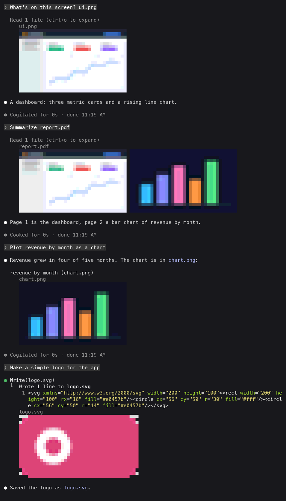
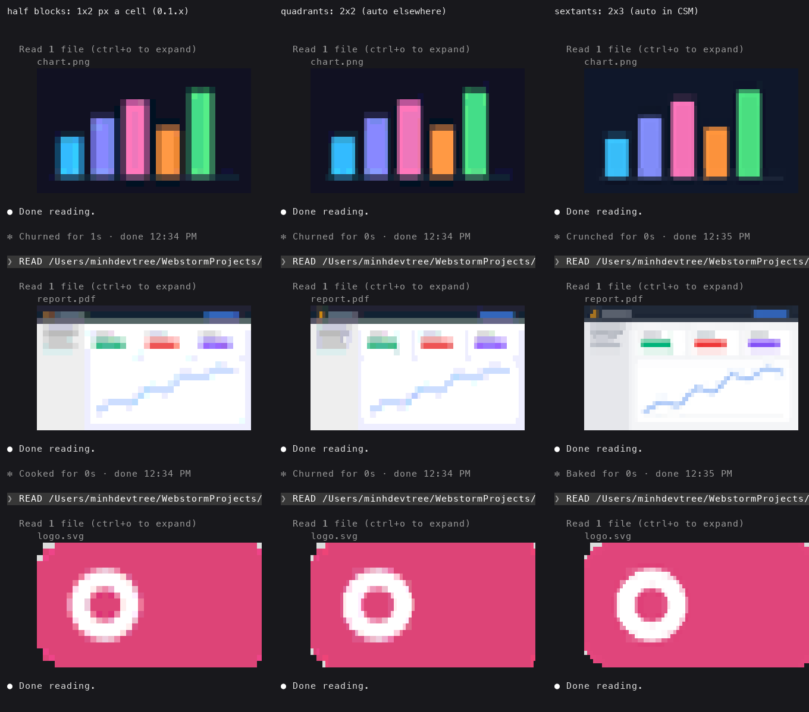
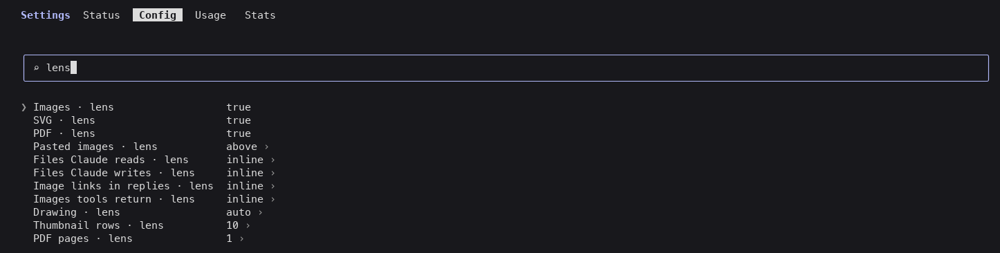

# claude-lens

See images, SVGs and PDF pages in Claude Code where they appear: the screenshot you paste, the file Claude reads,
the chart Claude writes, the image a tool returns, the picture a reply links to.



*In tmux, with no graphics protocol: every preview above is drawn with colored half blocks. In kitty and Ghostty
lens draws the real picture.*

## Install

Type this at the Claude Code prompt:

```
/plugin install lens --marketplace minhdevtree/claude-lens
```

Answer `y` to add the marketplace and pick a scope. lens works from the next message on.

<details>
<summary>From a shell instead</summary>

```bash
claude plugin marketplace add minhdevtree/claude-lens
claude plugin install lens@claude-lens
```

Then run `/reload-plugins` in a session, or start a new one.
</details>

## What you see, where

| Where Claude Code runs | What lens draws |
| --- | --- |
| kitty, Ghostty | The picture itself (kitty graphics protocol) |
| CSM (Claude Session Manager) | Colored blocks in the finest detail: each cell is split 2x3 (sextants), its two best colors |
| tmux, iTerm2, WezTerm, Terminal.app, the VS Code terminal, other apps built on xterm.js | Colored blocks, each cell split 2x2 (quadrants) |
| Claude desktop app, VS Code extension, mobile | SVG files only, drawn by the app; other previews are left out |



*The same three thumbnails at the same size in the three block details. Drawn from tmux captures, with each block
glyph painted as the terminal's own block shapes, as CSM's terminal does.*

Inside tmux, Claude Code uses 256 colors unless you set `CLAUDE_CODE_TMUX_TRUECOLOR=1` (in your shell or in the
`env` block of `~/.claude/settings.json`). The blocks look much better with it.

## What gets previewed

| Source | Example | Shown |
| --- | --- | --- |
| Pasted images | `[Image #1]` in your prompt | Above the prompt while you write, then under your message |
| Files Claude reads | Read of a PNG, SVG or PDF | Under the "Read 1 file" row |
| Files Claude writes | Write or Edit of an SVG, a Bash command that makes `out.png` | Under the tool's result |
| Image links in replies | `` | Under the reply, labelled the way Claude Code draws the link: `revenue by month (chart.png)` |
| Images tools return | An MCP or browser tool's screenshot | Under the tool's result |

File types: PNG, JPEG, GIF, WebP, BMP, TIFF, HEIC, SVG and PDF (the first pages). Web links are never fetched.

`/lens` opens a gallery of everything lens has shown this session.

## With other mods (claude-skins and similar)

Mods run as a chain, in the order your `~/.claude/settings.json` lists them under `enabledPlugins`, first on the
outside. A mod that redraws a row as its own card without passing the row on, as
[claude-skins](https://github.com/hellosverre/claude-skins) does for tool groups and prompts, keeps every mod listed
after it from drawing on that row.

lens handles this on its own: at the end of each turn, any preview that its row did not get shows in the band above
the prompt, under the line `lens: previews from this turn (another mod drew their rows)`, until you send the next
prompt. The `/lens` gallery always has everything.

To get those previews inline again, put `lens@claude-lens` before the other mod in `enabledPlugins` and start a new
session:

```json
"enabledPlugins": {
  "lens@claude-lens": true,
  "skins@hellosverre-mods": true
}
```

## Settings

Every setting is a row in `/config` (type `lens` to filter):



| Row | Values | Default |
| --- | --- | --- |
| Images, SVG, PDF | on / off per file type | on |
| Pasted images | `above` (over the prompt while you write, then under your message), `inline`, `pane` (gallery only), `off` | `above` |
| Files Claude reads, Files Claude writes, Image links in replies, Images tools return | `inline`, `pane` (gallery only), `off` | `inline` |
| Drawing | `auto` (pictures in kitty and Ghostty, blocks elsewhere), `kitty`, `blocks`, `text` (file names only) | `auto` |
| Block detail | `auto` (sextants in CSM, quadrants elsewhere), `sextant` (2x3 per cell), `quadrant` (2x2), `halfblock` (1x2, what 0.1 drew) | `auto` |
| Thumbnail rows | 2 to 40 | 10 |
| PDF pages | 1 to 8 | 1 |

Quick switches for the session:

| Command | Does |
| --- | --- |
| `/lens` | Opens the gallery |
| `/lens off`, `/lens on` | Hides or shows every preview (remembered) |
| `/lens status` | Shows the drawing mode, the settings and the converters found |
| `/lens clear` | Empties the gallery |

## Requirements

- Claude Code 2.1.294 or later (checked on 2.1.294 and 2.1.296).
- macOS: nothing to install. lens uses `sips` and PDFKit, which ship with macOS.
- Linux: lens uses what it finds.
  - PDF: `pdftoppm` (poppler-utils) or `mutool` (mupdf-tools)
  - SVG: `rsvg-convert` (librsvg2-bin) or ImageMagick
  - PNG, JPEG, GIF, WebP, and the colored blocks: ImageMagick (`magick` or `convert`)

  On Debian or Ubuntu: `sudo apt install poppler-utils librsvg2-bin imagemagick`.
- Windows: not supported yet (lens runs its converters through `/bin/sh`).

## Privacy

lens is local. It makes no network requests. It writes only to its cache folder, `$TMPDIR/claude-lens`, where it
keeps the thumbnails and the pasted or returned images it previews. It reads the files it previews and, for the band
above the prompt, Claude Code's own paste cache. `claude plugin validate` lists every call it makes.

## Troubleshooting

**Nothing appears.** Run `/lens status`. If it says "off for now", run `/lens on`. If it lists no converters on Linux,
install the packages above. Check that `/plugin` lists `lens` as active, or run `/reload-plugins`.

**I see the file name in brackets, not a picture.** Your terminal does not paint kitty graphics but Drawing is set to
`kitty`. Set it to `auto` or `blocks`.

**The blocks show as empty boxes or question marks.** Your terminal has no glyphs for sextants (U+1FB00 and on):
no font macOS ships has them, so Terminal.app and iTerm2 cannot draw them. Set Block detail to `quadrant` (or
`halfblock`). `auto` only picks sextants inside CSM, whose terminal draws them itself.

**The blocks look washed out.** In tmux, set `CLAUDE_CODE_TMUX_TRUECOLOR=1`. Elsewhere, check that your terminal
has truecolor (`COLORTERM=truecolor`).

**A preview is missing for a big PDF.** Claude Code refuses to Read a long PDF without a page range, and lens skips
reads that failed. Files over 64 MB are not converted.

**Previews show above the prompt, not under the rows.** Another mod draws those rows without passing them on. See
[With other mods](#with-other-mods-claude-skins-and-similar).

**A row I scrolled past has no picture.** On the main screen, finished rows are printed once. lens prepares each
preview as soon as Claude names the file, so this is rare; the `/lens` gallery always has it.

## Limits

- At most 255 pictures can be on screen at once in kitty and Ghostty (the terminal's image ids). Past that, Claude
  Code draws the file name instead.
- Half-block and quadrant thumbnails share a palette of 1024 color pairs per frame, so many at once lose some color.
  Sextants are drawn as colored text and keep theirs.
- Thumbnails are not shown for rows scrolled off screen in fullscreen mode.

## How it works

See [docs/DESIGN.md](docs/DESIGN.md). In short: lens is a Claude Code [mod](https://code.claude.com/docs/en/plugins/mods/overview).
It notices images as Claude Code stores each row of the conversation, turns each file into a PNG thumbnail with the
tools your OS has, and draws it under the row with Claude Code's `Image` element (kitty, Ghostty), or as colored
blocks: each cell's pixels are split into the two colors that fit them best and the block glyph of that split.

## Development

```bash
git clone https://github.com/minhdevtree/claude-lens
cd claude-lens
claude --plugin-dir .          # load it for one session; edits reload live
claude plugin validate .
claude plugin test .
npx -p typescript tsc -p .     # after one `claude --plugin-dir .`, which writes the API types
```

## Credits

- [claude-image-view](https://github.com/jarrodwatts/claude-image-view) by Jarrod Watts (MIT): the band of pasted
  images above the prompt, and how to find Claude Code's paste cache, come from it.
- The Claude Code mods documentation and the API types Claude Code ships.

## License

MIT. See [LICENSE](LICENSE).
